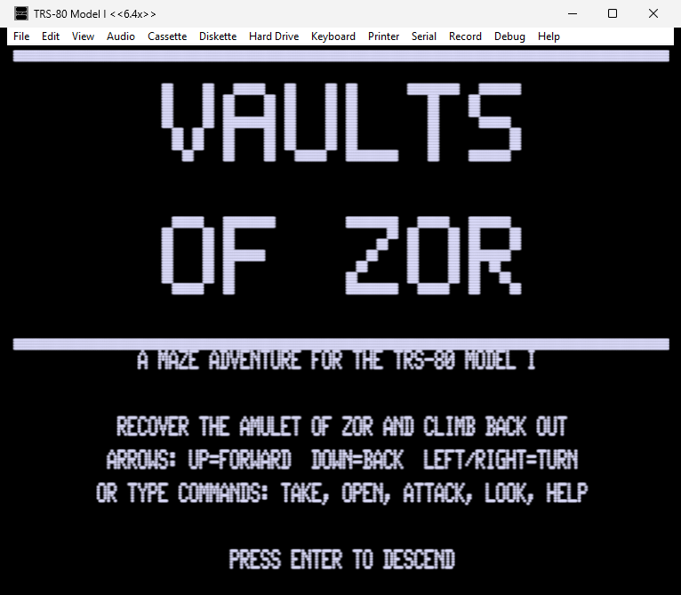
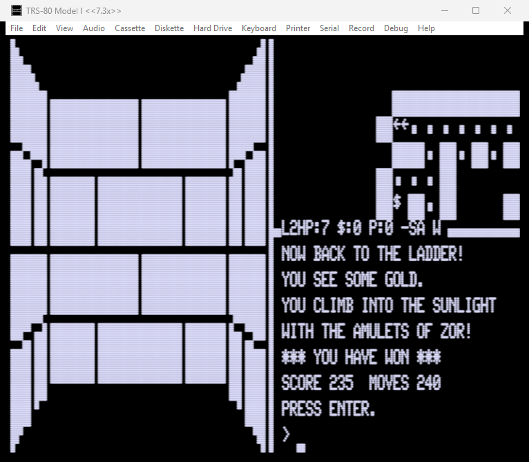
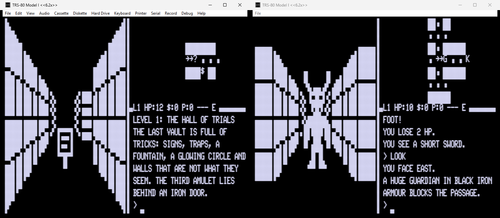
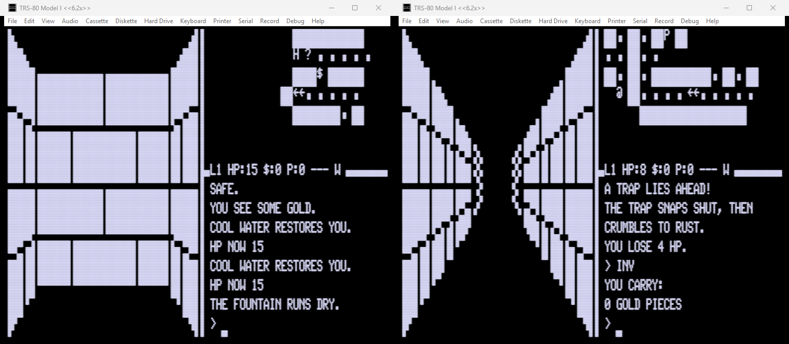
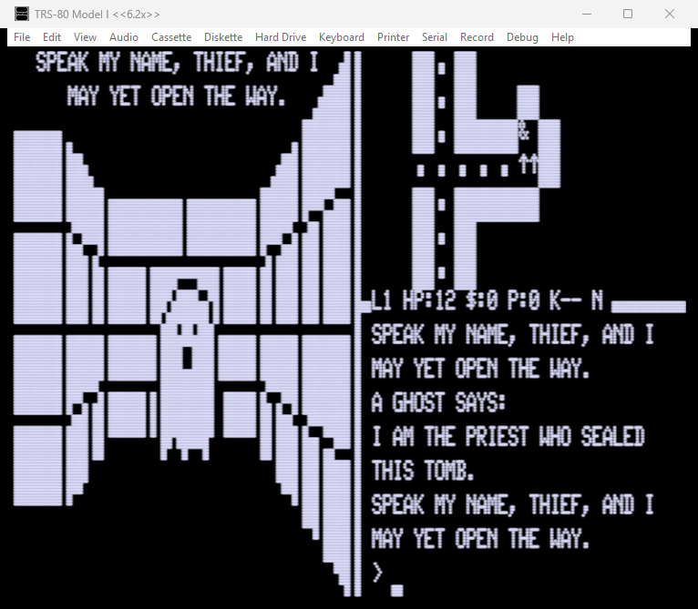
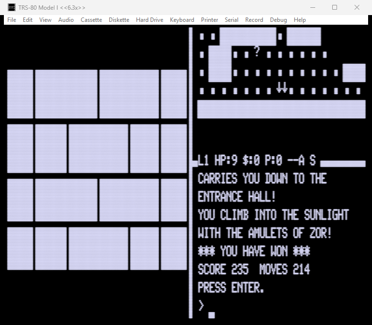
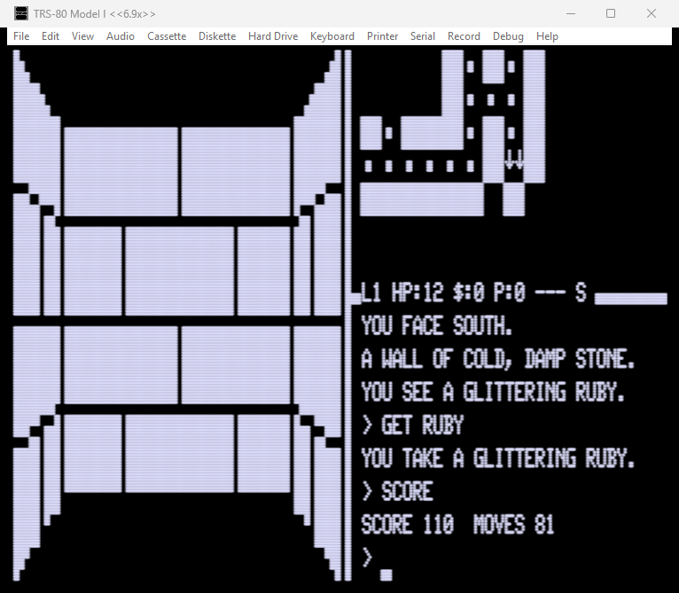
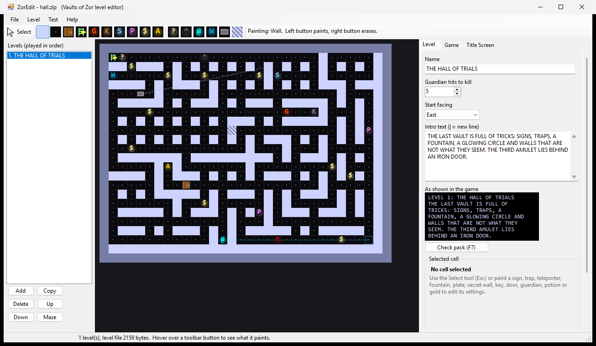
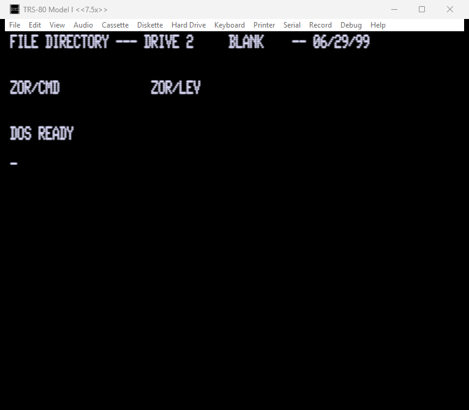

# VAULTS OF ZOR

A first-person maze adventure for a **TRS-80 Model I running TRSDOS 2.3 with 48K**, written in
**Z80 machine code**. It comes with **ZorEdit**, a Windows level editor. Levels live in
**level files on the TRSDOS disk**, so anyone can make new adventures without touching the code.

Nothing in a level is built into the game except walls and floor. Keys, doors, monsters,
characters, traps, signs, treasures and exits are all **objects you define** in ZorEdit, each with
its own look, its own words and its own **behaviours**, built from *When / If / Do* menus. A
library of ready-made objects gets a new adventure going in minutes.



| File | What it is |
|---|---|
| `ZOR.CMD` | The game, with the default four-level pack built in. Runs on its own. |
| `ZOR.LEV` | The same four levels as a separate level file for the TRSDOS disk |
| `ZorEdit.exe` | The level editor (Windows, needs only the .NET Framework 4 that comes with Windows) |
| `levels/default.zlp` | The default pack as editable text |
| `levels/library.zlp` | The object library ZorEdit copies ready-made objects from |

## Playing

On TRSDOS, from `DOS READY`:

```
ZOR                 play the levels built into ZOR/CMD, or ZOR/LEV from disk if none are built in
ZOR CASTLE/LEV      play the level file CASTLE/LEV (any drive, or CASTLE/LEV:1)
```

In trs80gp, the next command boots the built-in TRSDOS disk and runs the game straight away:

```bash
trs80gp -m1 ZOR.CMD
```

On the title screen, ENTER starts and BREAK returns to TRSDOS. `QUIT` in the game also goes back to TRSDOS.

### The screen

```
 col 0 ............ 31 | 32 | 34 .............. 63
+----------------------+    +----------------------+
|                      |    |  MAP  (15 x 7 cells) |  rows 0-6
|   3D VIEW            | ┃  |L1 HP:12 $:15 SC:40 E |  row 7  status line
|   32 x 16 chars      | ┃  |  TEXT OUTPUT         |  rows 8-14 (scrolls)
|   = 64 x 48 pixels   | ┃  |  > COMMAND INPUT_    |  row 15
+----------------------+    +----------------------+
```

* **3D view:** first-person view with solid perspective brick walls, doors, and sprites for the
  objects in view.
* **Map:** top-down plan centred on you. Cells appear once you have seen them.
* **Text:** status line (level, HP, one counter the pack chooses such as gold, score, compass),
  messages and the command line.


### Controls

With the command line empty, the **arrow keys** act at once: ↑ step forward, ↓ step back, ← → turn.
Otherwise type a command and press ENTER. The built-in commands are:

| Command | Effect |
|---|---|
| `F` `B` `L` `R`, `TURN [LEFT/RIGHT]`, `AROUND` | move / turn |
| `TAKE` / `GET` (G), `DROP` | pick up or put down something that can be carried |
| `TALK` / `SPEAK` / `ASK` / `GREET` / `HELLO` | talk to the character in front of you (walking into them works too) |
| `LOOK` (X), `INV` (I), `SCORE` (S), `HELP` (H or ?), `QUIT` (Q) | |

Every other word (`OPEN`, `ATTACK`, `DRINK`, `LIGHT LAMP`, `SAY AMENTEP`…) comes from the pack's
behaviours. A word the pack knows but which does nothing right now gets "YOU CAN'T DO THAT... YET."

**In the default pack** each level starts on a ladder: find the amulet and climb back out. HP, the
gold counter and anything marked *kept* (the sword, potions) carry on to the next level. Every
action is a turn, and a guardian next to you may strike at the end of it. Gold, puzzles and each
amulet brought out score points.



### Objects

Every object on a level belongs to a **kind of object** defined in the pack:

| Setting | What it does |
|---|---|
| Id | one word scripts use for it (`door`, `guardian`, `ruby`) |
| Name | how the game names it: "A STOUT DOOR", "THE GUARDIAN" |
| Looks like | its sprite: wall, door, ladder, guardian, key, sword, potion, gold, amulet, sign, trap, teleporter, fountain, plate, hermit, merchant, ghost, thing, or nothing (invisible) |
| Solid / can be carried / kept on the next level | whether it blocks the way, can be picked up, and comes with you down the ladder |
| Nouns | the words the player can type for it (`GUARDIAN,MONSTER`) |
| Value | a starting number each placed one keeps for itself: hit points, uses, an amount of gold |
| Description | what `LOOK` says |
| Behaviours | what it does (see below) |

Each **placed object** can also have its own value, two numbers P1 and P2 (for example a
teleporter's destination or the cell a pressure plate opens), its own description, two more texts
for it to say or speak, a name so level behaviours can refer to it, and behaviours of its own.

**Speech.** A character's texts appear over the 3D view without a box, a short sentence at a time.
Each word comes out of the speaker's mouth and drifts up into its place in the sentence above
their head. A finished sentence stays up for a moment, then the next one takes its place. Any key
hurries the speech along. The whole speech, under "AN OLD HERMIT SAYS:" and so on, is also written
in the text window.


*The hermit speaking, captured every 150 ms. The streaks in a few frames are the real Model I's
screen "snow", which trs80gp copies.*





*A sign, a guardian's own description, a fountain running dry and a visible one-shot trap, all in
the Hall of Trials.*

### Behaviours

A behaviour is one rule: **when** something happens, **if** some conditions hold, **do** some
actions. In ZorEdit you build them from menus; the editor writes the rule as a line of text, which
you can also type directly:

```
on OPEN if ahead this and matches key then useup key; remove this; say "THE KEY TURNS."
on bump then say "THE DOOR IS LOCKED."
every turn if near this and chance 35 then say "THE GUARDIAN GORES YOU!"; hurt 3 random
on arrive if at 29,21 and present litlamp then say "YOU SEE A LOOSE STONE."; set spotted
```

Behaviours can belong to a **kind of object** (every door), to **one placed object** (this
merchant), to a **level** (things that happen in a cell, or puzzles that involve several objects),
or to the **whole pack**. In an object's behaviours, `this` is the object itself, `value` and `p1`
are its numbers, and `target` is the cell P1,P2.

| When | |
|---|---|
| `on VERB [NOUN \| any]` | the player types a command. The rules of the objects here, then in front, then carried are tried; the first that acts ends the command (`continue` lets the built-in command run too). If the noun is only something carried (`USE KEY`), the object in front is asked too. |
| `on arrive` | the player steps onto it (or, at level scope, into any cell) |
| `on bump` | the player walks into it (a solid object) |
| `every turn`, `on start` | after every turn; when the level starts |
| `synonym NEW = WORD` | another word for a verb or noun |

In automatic triggers (arrive, bump, every turn, start) every rule that holds acts, unless one says `stop`.

| Conditions (`not` in front reverses) | Actions |
|---|---|
| `has TYPE [N]`, `carried OBJ`, `here OBJ\|TYPE`, `present OBJ`, `exists OBJ`, `near OBJ` | `say "TEXT"`, `say OBJ N`, `speak "TEXT"`, `speak OBJ N`, `die "TEXT"` |
| `ahead OBJ\|TYPE\|X,Y`, `at X,Y`, `is TYPE`, `matches TYPE` (same P1) | `give TYPE [N]`, `take TYPE [N]`, `useup TYPE`, `create TYPE at X,Y`, `become TYPE` |
| `flag NAME` | `get OBJ`, `drop OBJ`, `remove OBJ`, `put OBJ at X,Y`, `swap OBJ OBJ` |
| `counter NAME >= N` (`>` `=` `<` `<=`) | `set FLAG`, `clear FLAG`, `counter NAME = N`, `add NAME N`, `sub NAME N` |
| `value [OBJ] >= N`, `hp >= N` | `value [OBJ] = N`, `value + N`, `value - N`, `score N`, `hurt N [random]`, `heal N` (0 = fully) |
| `chance PERCENT` | `cell X,Y floor\|wall\|open`, `goto X,Y`, `next` (level), `win`, `inventory`, `look`, `continue`, `stop` |

A pack has 32 flags and 16 counters (0-65535), shared by all its levels. One counter can be shown
on the status line, like `$:` for gold. `#` starts a comment, and a line starting with a space
continues the one before.

### The object library

**Library...** on the Objects tab copies ready-made objects into a pack, where you can change or
delete them. Objects another one needs come too (a door brings a key).

| Object | |
|---|---|
| key, door | a door opens with a carried key whose P1 matches its own, so a level can have many locks |
| sword, guardian | the guardian blocks the way, fights back and needs the sword; its value is its hit points |
| potion, fountain | heal by the potion's value; the fountain heals fully and runs dry after its value in drinks |
| gold, chest | add to the gold counter and the score |
| amulet, ladder, stairs | the ladder ends the level if you carry the amulet; stairs end it at once |
| sign, trap, teleporter, plate, secret | a sign shows its text, a hidden trap becomes visible, a teleporter and a plate use the cell P1,P2, a secret wall can be walked through |
| hermit, merchant, ghost | talk with texts 2 and 3; the merchant sells a potion for 15 gold; the ghost steps aside |

### Level 4: The Sand Pyramid

The default pack ends in a pyramid tomb, built to show what objects and behaviours can do
together. Its map narrows from wide galleries at the base to the burial chamber at the apex. The
puzzles chain together:

1. Take the **torch** from the entrance hall. The hieroglyphs there hint that fire undoes the
   dead and that not every wall is stone.
2. Find a **shovel** in the store room and `DIG` in the sand chamber's strange mound: a golden
   **scarab**.
3. At the sealed wall north of the hall, `PLACE SCARAB` in its beetle-shaped hollow, and the wall
   sinks into the floor.
4. `LIGHT TORCH` at the **burning brazier**. The torch burns for 45 turns, and you can relight it
   there.
5. A **mummy** blocks the way up and no blade can hurt it: `BURN MUMMY` (or `ATTACK MUMMY`) with
   the lit torch.
6. In the middle gallery, the hieroglyphs name the high priest, and a side room holds a silver
   **ankh**.
7. The priest's **ghost** asks for his name: `SAY AMENTEP`, and he gives you the **gold key**.
8. The gold key opens the door to the burial chamber. `OPEN SARCOPHAGUS` releases the amulet,
   and the Pharaoh's **curse**: without the ankh, it burns you every few turns.
9. Step onto the **sun disc** in the upper gallery to be carried back to the entrance hall, then
   climb the ladder.





The first level has a smaller side quest in the same style: light the lantern, find the dark
corner, `MOVE STONE` for a ruby.



## Making levels with ZorEdit



* **Start:** File > New Pack gives one empty level with no objects. Press **Library...** on the
  Objects tab to copy ready-made objects in, or **New** to make your own kind of object.
* **Map:** walls and floor only. Pick Wall, Floor or Start on the toolbar (keys 1-3) and paint;
  the other button paints the opposite. Click the start again to turn the player. The outer ring
  is always wall. Each level is 32 × 24 cells.
* **Objects:** every kind of object has a toolbar button (keys 4-0 for the first seven). Click a
  cell to place one. Pick **Select** (Esc) and click a cell to edit what is there under
  **Selected object** on the Level tab: its own value, P1/P2 (**Pick target on map** for a
  teleporter or plate), name, texts and behaviours.
* **Right-click a cell** for its menu: place an object; for each object there, select it, add a
  behaviour to that one object or to every object of its kind, pick its target or remove it; add
  a behaviour to the cell itself (stepping onto it or walking into it) or edit the ones it has;
  move the start; switch wall and floor.
* **Behaviours:** each list (on a placed object, a kind of object, the level, the whole pack)
  shows its rules one per line. **Add...** or a double-click opens the builder: choose *When*, add
  *If* conditions and *Do* actions from drop-downs (they offer your kinds of object, named objects,
  flags and counters), and see the rule as text and whether it compiles. A **Map** button beside a
  cell or object field picks it on the level map; an unnamed object is given a name so a rule can
  refer to it. Tick **As text** to edit the rules directly.
* **Undo / Redo (Ctrl+Z / Ctrl+Y)** step through your changes to the pack. Inside a text box
  Ctrl+Z undoes typing in that box.
* **Map markers:** cells with level behaviours have a green corner, objects with behaviours of
  their own a magenta dot, and arrows show where teleporters and plates lead.
* **Objects tab:** the kinds of object in the pack, their settings and their behaviours. Renaming
  an id renames the placed objects too.
* **Scripts tab:** the level's behaviours and the pack's, and **Reference** (Shift+F1).
* **Game tab:** victory text, starting and maximum HP, and the counter shown on the status line.
  **Title tab:** two lines of big banner text, a subtitle and three text lines, with a live preview.
* **Levels list:** up to 9 levels, played in order. **Maze** (Ctrl+G) carves a random maze.
* **Test > Check Pack (F7)** compiles everything and reports problems: script errors, a start
  inside a wall or on a solid object, objects inside walls, a level nothing finishes (no `next` or
  `win`), intro text too long, and a pack too big for memory.
* **Test > Play in Emulator (F5)** builds the game and runs it in trs80gp. **Shift+F5** boots
  TRSDOS, copies the game and the level file onto a blank disk with IMPORT2, and runs `ZOR`.
  **F6** plays only the level you are editing; **Shift+F6** (or right-click > *Play this level from
  here*) starts it at the selected cell. The pack itself is not changed.
* **File > Export Level File** writes a `.LEV` file for your TRSDOS disk. **Export Game** writes a
  single `.CMD` with the levels built in. **Export Game Engine only** writes a `ZOR.CMD` that loads
  `ZOR/LEV`.
* **Older packs** (from before user-defined objects) are converted when opened: every old kind of
  cell becomes an ordinary kind of object you can change. Save the result under a new name.

Packs are saved as `.ZLP` text files, so you can also edit them in Notepad:

```ini
[pack]
format=5
banner1=VAULTS
victory=YOU CLIMB INTO THE SUNLIGHT WITH THE AMULETS OF ZOR!
starthp=12
status=gold,$:
script=
synonym KILL = ATTACK
endscript

[object]
id=guardian
name=THE GUARDIAN
look=guardian
flags=solid
nouns=GUARDIAN,MONSTER
value=3
desc=THE HORNED GUARDIAN GLARES AT YOU.
script=
on ATTACK if ahead this and has sword and chance 70 then value - 1; say "YOUR SWORD BITES DEEP!"
every turn if value < 1 then remove this; say "THE GUARDIAN CRASHES DOWN, DEAD!"
endscript

[level]
name=THE UPPER VAULTS
intro=FIRST PARAGRAPH...|SECOND PARAGRAPH (| = new line)
start=1,1,E
map=
################################
#...#.....#.......#...#.......##
...24 rows of # (wall) and . (floor)
obj=10,15,guardian          ; a placed object, then its own settings:
ovalue=4
obj=11,21,merchant
otext2=FINE POTIONS! ONLY 15 GOLD.
oscript=
on TALK if value < 1 and counter gold >= 15 then speak this 2; sub gold 15; give potion; value = 1
endscript
obj=nowhere,ruby            ; not on the map yet (or obj=carried,TYPE)
oname=ruby
script=
on MOVE STONE if at 29,21 then put ruby at 29,21
endscript
```

ZorEdit also works from the command line (`build.ps1` uses this):

```
ZorEdit.exe /cmd pack.zlp ZOR.CMD        game with the pack built in
ZorEdit.exe /lev pack.zlp CASTLE.LEV     level file
ZorEdit.exe /engine ZOR.CMD              engine only
ZorEdit.exe /check pack.zlp              check the pack
ZorEdit.exe /convert old.zlp new.zlp     convert an older pack
ZorEdit.exe /preview pack.zlp title.png  title screen picture
```

### Getting level files onto a TRSDOS disk in trs80gp

trs80gp's built-in utilities disk has `IMPORT2`, which copies host files through its FreHD emulation:

```
trs80gp -m1 -frehd_dir C:\mylevels -d1 :tu1 -d2 :tb1
IMPORT2 castle.lev CASTLE/LEV:2
ZOR CASTLE/LEV
```

`:tu1` is the utilities disk and `:tb1` a blank TRSDOS disk. The built-in TRSDOS boot disk in
drive 0 is write-protected. Use **Diskette > Drive 2 > Save** to keep the disk as a `.dsk` file.



## Building

Needs Python 3 and [zmac](https://48k.ca/zmac.html). ZorEdit compiles with the C# compiler that
ships with Windows.

```powershell
.\build.ps1          # gen.py -> zmac -> ZorEdit.exe -> ZOR.CMD + ZOR.LEV
.\build.ps1 -Run     # ...and run ZOR.CMD in trs80gp
```

The build script and test harness look for zmac and trs80gp in `tools\zmac` and
`tools\trs80gp\windows` first, then on your PATH. You can also set `$env:ZMAC` and `$env:TRS80GP`.
The tools are not included in this repository: unzip
[zmac.zip](https://48k.ca/zmac.zip) into `tools\zmac` and
[trs80gp](https://48k.ca/trs80gp.html) into `tools\trs80gp`.

The ready-built `ZOR.CMD`, `ZOR.LEV` and `ZorEdit.exe` in the repository root are what
`build.ps1` produces, so you can play and edit levels without building anything.

| Source | Purpose |
|---|---|
| `zor.asm` | The game engine (Z80): pack loader, renderer, map, text window, parser, speech |
| `rules.asm` | Objects and behaviours: level loading, the rule interpreter, conditions and actions, moving and arriving (included by `zor.asm`) |
| `gen.py` | Pre-renders the wall segments and sprites into `gfx.inc`. (`--levels` writes an old-format two-level pack, which ZorEdit converts on opening.) |
| `editor/*.cs` | ZorEdit: `Pack.cs` (pack model, `.ZLP` files, compiler, checker, maze generator), `Script.cs` (behaviour language), `Behaviour.cs` (behaviour builder, behaviour lists, library), `Convert.cs` (older packs), `MainForm.cs` (UI), `Program.cs` (command line) |
| `levels/` | `default.zlp` (the four-level pack) and `library.zlp` (ready-made objects, also built into ZorEdit) |
| `DESIGN-OBJECTS.md` | The design of user-defined objects and the level file format in full |
| `test/` | Test harness: `play.ps1` / `shot.ps1` drive trs80gp through the keyboard matrix and capture the screen, `route.py` builds a key sequence for a route through a level (from `default-v4.zlp`), `v5pack.py` builds small test packs, `burst.ps1` captures animation frames |
| `tools/` | zmac and trs80gp from 48k.ca (not in the repository; see above) |

## Technical design

**TRSDOS program.** `ZOR/CMD` loads at `5200H`, just above TRSDOS 2.3. It reads the command line
from HL, loads files with the TRSDOS SVCs (`@FSPEC 441CH`, `@OPEN 4424H`, `@READ 4436H`,
`@CLOSE 4428H`) and leaves through `@EXIT 402DH`. It reads keys with the ROM keyboard routine and
writes straight to video RAM at `3C00H`. The engine, with four sets of pre-rendered wall and
sprite graphics and the rule interpreter, ends at about `CDC0H`. A level file is loaded into the
free memory after it, which leaves about 12.5K for levels in 48K. The 4-level default pack is
11.4K, so `ZOR.CMD` with it built in runs to `FB31H`. Check Pack warns when a pack won't fit.

**Level file format, version 5** (`.LEV` = the pack ZorEdit compiles). The full layout, with
every condition and action code, is in [DESIGN-OBJECTS.md](DESIGN-OBJECTS.md) section 7. In short:

- A header (`"ZORPACK"`, version 5, length, number of levels, starting and maximum HP, number of
  object types, the status counter and its label) and pointers to the title screen, victory text,
  vocabulary, object types, pack rules and pack texts, then one pointer per level.
- **Object types**, 6 bytes each: look, flags (solid, carry, keep), noun, starting value, name
  text, description text.
- **Each level:** start x, y and facing; pointers to its name, intro, placed objects, rules and
  texts; then 96 bytes of terrain (one bit per cell).
- **Placed objects**, 8 bytes each: x, y, type, value, P1, P2 and a text (description and
  speeches). On loading, the engine copies them to RAM, up to 64; changes during play (hit points
  counting down, a trap found, a fountain's drinks) live there.
- **Rules:** verb, noun and scope (which kind of object, or none), then 4 bytes (op, a, b, c) per
  condition and per action. A condition op with bit 7 set is negated.

A pack built into the `.CMD` uses the same format. ZorEdit finds the engine's built-in pack marker
and replaces everything from there on. If the built-in pack has no levels, the game loads `ZOR/LEV` instead.

**3D renderer.** The view is not raycast. Like classic grid-based dungeon games, it is assembled
from pre-rendered pieces. For each depth there is a left and right side segment (wall, opening with
a wall face beyond, or open darkness) and a front face (wall or door). `gen.py` rasterises them once
into semigraphic characters. Each frame the Z80 looks up the 15 cells in the view cone, copies the
right pieces into a 32×16 buffer, masks in the nearest sprite, and copies the buffer to the screen
in one pass, so frames don't flicker. A frame takes about 30 ms on a 1.77 MHz Model I.

**Smooth movement.** Each step is animated with three in-between frames, and each turn with a
three-frame pan.

* *Steps:* `gen.py` renders the walls and sprites for four phases, with the viewer 0, ¼, ½ and ¾ of
  a cell further forward. At phase f, boundary k sits at distance k − f on a smooth perspective
  curve. The cells in view stay the same, so the renderer just switches to that phase's tables
  (`PHASETAB`). Stepping forward shows phases 1, 2, 3 from the old cell. Stepping back shows
  phases 3, 2, 1 from the new cell.
* *Turns:* the new view is drawn off screen and slides in over the old one, 8 columns per frame,
  from the side you turn towards. `AROUND` is two right turns.
* *Speed:* a step takes about a fifth of a second. Tune it with `FRAMEDLY` in `zor.asm`.


*A step forward (frames 1-5: the end wall grows through the ¼, ½ and ¾ frames) and a right turn
(frames 6-15), captured from a slowed-down build.*

**Keyboard.** The ROM keyboard routine only sees a key while it is being called, and it debounces,
so it drops a key that has already been released. During animation and redraws the engine
therefore polls the keyboard often (between frames, inside the renderer, on every map row). Any
key it sees goes into a 16-key type-ahead queue, which the command line reads first. Keys pressed
while a step is still animating are not lost.

**Map and fog of war.** Bit 7 of each maze byte marks a cell as seen. The renderer sets it on every
cell it draws, and the map shows only seen cells.

## Testing done

All of this was run in trs80gp (Model I, 48K), with keys sent through the emulated keyboard matrix:

* **The default pack**, all four levels played through: level 1 to "LEVEL COMPLETE"; level 2
  (sword, guardian killed, key, door, amulet, ladder); level 3 (hidden trap, sword, armoured
  guardian, iron key and door, amulet, ladder into the pyramid); level 4 (shovel, torch, scarab,
  sealed wall, ankh, brazier, burning the mummy, `SAY AMENTEP`, golden door, sarcophagus, amulet,
  sun disc, ladder) to "YOU HAVE WON". Levels 2-4 were played from test packs that start at that
  level.
* The level 1 side quest (lantern lit, burning out, the hermit's speech and potion) and the
  level 3 mechanics one by one (sign, traps, fountain, ghost, secret wall, teleporter, plate).
* **A pack built from nothing** with library objects (sign, gold, door with its key, stairs) and a
  cell behaviour made with the builder, played to the win; `USE KEY` and `UNLOCK DOOR` open the
  door.
* **Counters** past 255: 600 gold, comparisons, `counter = N`, adding to 65535 and stopping there,
  subtracting below 0 and stopping at 0, a five-digit status line.
* Long random walks of 160 keys, including stepping back.
* **ZorEdit:** every rule of the default pack and the library goes through the behaviour builder
  and back to identical compiled bytes; the builder opens on every rule of the default pack; the
  main window loads the default pack; command-line export, check and convert work.

Not yet checked: clicking through ZorEdit's dialogs by hand, and the game on real hardware.

Test-harness quirks: guardian fights are random and depend on timing, so a long scripted run can
be killed and restart from the title screen, which looks like a hang. A few runs received key
presses that were never sent, probably host keystrokes reaching the emulator window.

## Licence

Vaults of Zor and ZorEdit are released under the [MIT licence](LICENSE).

zmac, trs80gp and the TRSDOS disk images built into trs80gp are separate works by their own
authors. They are not part of this repository or covered by its licence.
