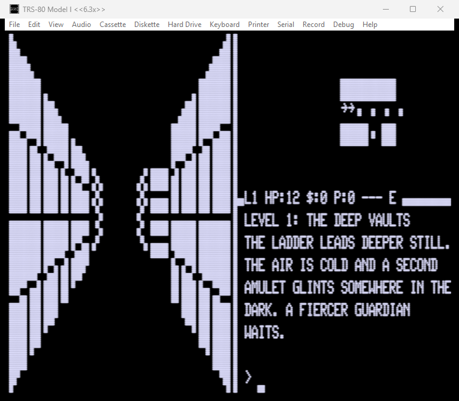
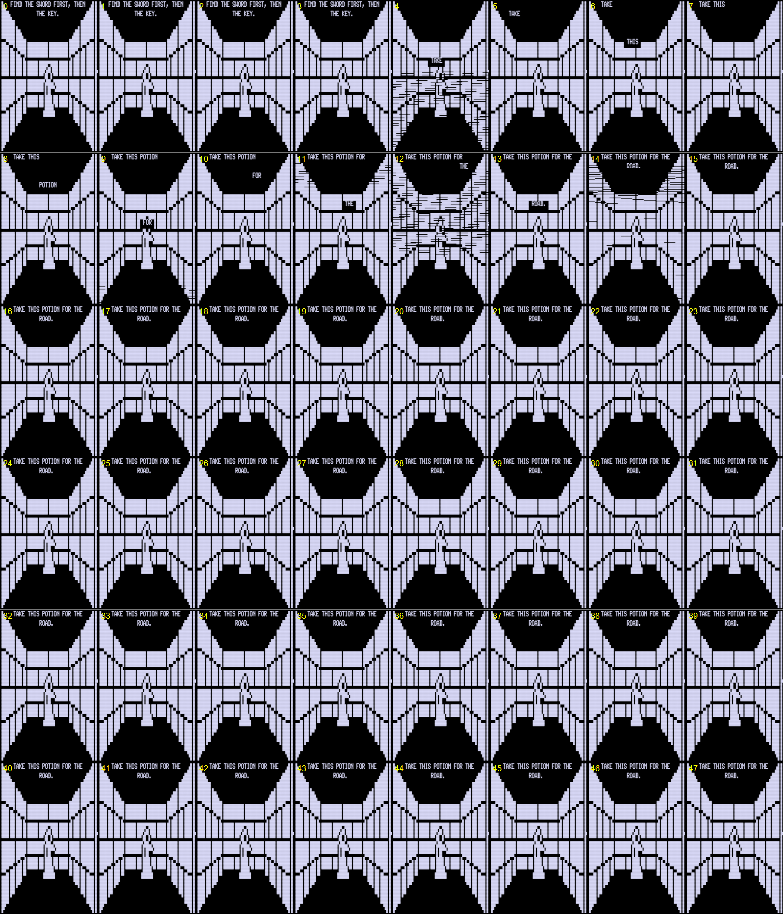
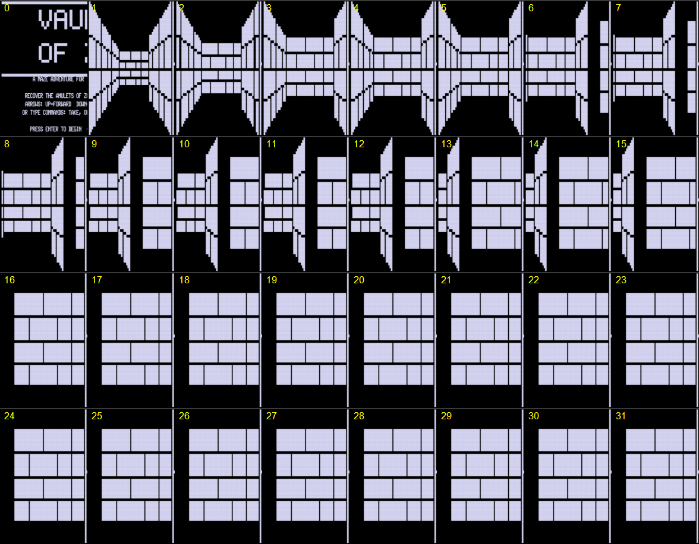

# VAULTS OF ZOR

A first-person maze adventure for a **TRS-80 Model I running TRSDOS 2.3 with 48K**, written in
**Z80 machine code**. It comes with **ZorEdit**, a Windows level editor. Levels live in
**level files on the TRSDOS disk**, so anyone can make new adventures without touching the code.


| File | What it is |
|---|---|
| `ZOR.CMD` | The game, with the default four-level pack built in. Runs on its own. |
| `ZOR.LEV` | The same four levels as a separate level file for the TRSDOS disk |
| `ZorEdit.exe` | The level editor (Windows, needs only the .NET Framework 4 that comes with Windows) |
| `levels/default.zlp` | The default pack as editable text |

## Playing

On TRSDOS, from `DOS READY`:

```
ZOR                 play the levels built into ZOR/CMD, or ZOR/LEV from disk if none are built in
ZOR CASTLE/LEV      play the level file CASTLE/LEV (any drive, or CASTLE/LEV:1)
```

In trs80gp, the next command boots the built-in TRSDOS disk and runs the game straight away:

```bash
trs80gp -m1 ZOR.CMD
```

On the title screen, ENTER starts and BREAK returns to TRSDOS. `QUIT` in the game also goes back to TRSDOS.

### The screen

```
 col 0 ............ 31 | 32 | 34 .............. 63
+----------------------+    +----------------------+
|                      |    |  MAP  (15 x 7 cells) |  rows 0-6
|   3D VIEW            | ┃  |L1 HP:12 $:15 P:1 KSA |  row 7  status line
|   32 x 16 chars      | ┃  |  TEXT OUTPUT         |  rows 8-14 (scrolls)
|   = 64 x 48 pixels   | ┃  |  > COMMAND INPUT_    |  row 15
+----------------------+    +----------------------+
```

* **3D view:** first-person view with solid perspective brick walls, doors, and sprites for the
  guardian, items and the exit ladder.
* **Map:** top-down plan centred on you. Cells appear once you have seen them.
* **Text:** status line (level, HP, gold, potions, Key/Sword/Amulet, compass), messages and the command line.



### Controls

With the command line empty, the **arrow keys** act at once: ↑ step forward, ↓ step back, ← → turn.
Otherwise type a command and press ENTER (one-letter shortcuts in brackets):

| Command | Effect |
|---|---|
| `F` `B` `L` `R`, `TURN [LEFT/RIGHT]`, `AROUND` | move / turn |
| `TAKE` / `GET` (G) | pick up what is here |
| `OPEN` / `UNLOCK` (O), `USE KEY` | unlock the door in front of you. Each key opens one door |
| `ATTACK` / `FIGHT` / `KILL` (A) | attack the guardian in front of you (needs the sword) |
| `DRINK` (D), `USE POTION` | drink a potion |
| `TALK` / `SPEAK` / `ASK` / `GREET` / `HELLO` | talk to the character in front of you (walking into them works too) |
| `LOOK` (X), `INV` (I), `SCORE` (S), `HELP` (H or ?), `QUIT` (Q) | |

**Each level:** start on the ladder, find an amulet, and climb back out up the ladder. HP, gold,
potions and the sword carry over to the next level. Keys and the amulet don't. Every action is a
turn, and a guardian next to you may strike at the end of it.
Score = gold + 5 × HP + 100 per amulet brought out.


### Objects and spaces

Objects and the floor itself can have **settings** and **behaviour**. Each cell can carry its own
settings, made in ZorEdit; a 0 always means "use the default".

| Cell | Map | Settings | What happens in the game |
|---|---|---|---|
| Gold | `$` | amount (0 = random, using the pack's min/max) | `TAKE` adds it to your gold |
| Potion | `P` | heal strength (0 = pack setting) | each potion you carry keeps its own strength; `DRINK` uses the last one taken |
| Key | `K` | colour 0-3 (brass, iron, silver, gold; names on the Game tab) | inventory counts keys per colour |
| Door | `#` | key colour needed | `OPEN` uses up a key of that colour; `LOOK` says which key it takes |
| Guardian | `G` | hit points, max damage per blow, attack chance %, description | each guardian has its own HP, strength and LOOK text |
| Sign | `?` | text | stepping on it (or `LOOK` while standing on it) shows the text |
| Trap | `*` once seen | damage, visible or hidden, works once or every time, message | hidden traps don't show in the 3D view or on the map until they go off |
| Teleporter | `@` | destination cell, message | stepping on it moves you there (no chains) |
| Fountain | `W` | heal (0 = fully), uses (0 = never runs dry), message | heals you when you step on it; when the uses run out it runs dry and disappears |
| Pressure plate | `=` | cell to open, message | the first time you step on it, the target cell (a wall or door) becomes open floor |
| Secret wall | (wall) | message when found | looks like wall in the 3D view, on the map and to `LOOK`, but you can walk through it |

Signs, traps, teleporters, fountains and plates have their own sprites in the 3D view, and they
scale with the smooth-movement frames like everything else.


*Left: a sign right ahead at the start of the Hall of Trials. Right: `LOOK` shows a guardian's
own description.*

The default pack's third level, **The Hall of Trials**, uses all of these.


*A fountain with 2 uses running dry, and a visible one-shot trap.*

### Characters and speech

Three kinds of character can stand in the vaults: a **hermit**, a **merchant** and a **ghost**,
each with its own sprite (human-sized, so the guardian still towers over them). They block the
way. Walk into one, or type `TALK`, and they speak.

**Speech** appears over the 3D view without a box. It comes a short sentence at a time, and each
word comes out of the speaker's mouth and drifts up into its place in the sentence above their
head. A finished sentence stays up for a moment, then the next one takes its place. The last one
stays until your next action. Any key hurries the speech along; those keys are not used as
commands. The whole speech, under "AN OLD HERMIT SAYS:" and so on, is also written in the text
window so you can read it again.



*The hermit speaking. Frames 0-3: a sentence is up. Frames 4-14: the next one, "TAKE THIS POTION
FOR THE ROAD.", builds up word by word as each word flies up from the hermit. Captured every
150 ms. The streaks in a few frames are the real Model I's screen "snow", which trs80gp copies.*

Each character has settings:

| Setting | Values |
|---|---|
| Looks like | hermit, merchant or ghost |
| Does | **talk** only, **give** an item, **sell** an item for gold, **heal** the player, or **step aside** (vanish) after talking |
| Amount | the gold price, the gold given, or the HP healed (0 = fully) |
| Item | a key of colour 0-3, the sword, a potion, gold, or even the amulet |
| First speech | said the first time; giving, selling, healing or stepping aside happens straight after |
| Later speech | said once the deed is done (blank = repeat the first speech) |

A merchant you can't afford tells you how much gold you need, and you can come back later.

In the default pack, a hermit in level 1 gives you a potion and a hint, a merchant in level 2
sells potions for 15 gold, and a ghost in the Hall of Trials guards the fountain until you speak
to it.

### Adventure scripting: open-ended puzzles

On top of the fixed rules, every level can carry a **script** in the style of the classic
two-word adventures:
- **Items:** a level's own objects (a lantern, a rope, an idol…) lie in the maze. You can `GET`,
  `DROP` and `EXAMINE` them; they appear as a small chest in the 3D view and as `+` on the map.
- **Words:** the designer can invent new verbs and nouns (`LIGHT LAMP`, `MOVE STONE`, `READ SCROLL`,
  `PRAY`…), with synonyms.
- **Game state:** 32 **flags** and 8 **counters** remember what has happened, across all levels of a pack.
- **Rules:** each rule says "when the player types this (or every turn, or on arriving in a cell),
  if these conditions hold, do these things". Rules can also change what the built-in commands
  do, for example a special response to `OPEN DOOR` in one place.

The command parser tries the level's rules first, then the built-in command. A verb the script
knows but whose rules don't apply right now gets "YOU CAN'T DO THAT... YET.", and points from
`score` actions add to your score.

The default pack's first level has a small side quest showing it off:
1. Find a dusty lantern and `LIGHT` it (or `IGNITE` it). It burns for 40 turns, then runs out of oil.
2. Carry it into a pitch-black corner, where it reveals a loose stone.
3. `MOVE STONE` (or `PUSH`/`PULL`) to find a ruby worth 50 points.


*After `MOVE STONE`: `LOOK` shows the ruby, `GET RUBY` takes it, and the score includes the
script's 50 points.*

Here is part of that script, as you would write it on ZorEdit's Script tab:

```
item lamp "A DUSTY LANTERN" at 11,21 nouns LANTERN,LAMP desc "AN OLD BRASS LANTERN."
item litlamp "A LIT LANTERN" nowhere nouns LANTERN,LAMP desc "IT BURNS WITH A STEADY FLAME."
item ruby "A GLITTERING RUBY" nowhere nouns RUBY,GEM
synonym IGNITE = LIGHT
on LIGHT LAMP if carried lamp and flag noil then say "THERE IS NO OIL LEFT."
on LIGHT LAMP if carried lamp then swap lamp litlamp; counter oil = 40;
  say "THE WICK CATCHES. THE LANTERN GLOWS."
every turn if carried litlamp then sub oil 1
every turn if carried litlamp and counter oil < 1 then swap litlamp lamp;
  say "THE LANTERN SPUTTERS AND GOES OUT."; set noil
on arrive if at 29,21 and present litlamp and not flag moved then
  say "BY LANTERN LIGHT YOU SEE A LOOSE STONE IN THE WALL."; set spotted
on MOVE STONE if at 29,21 and flag spotted and not flag moved then put ruby at 29,21;
  set moved; score 50; say "THE STONE SLIDES OUT. SOMETHING GLITTERS BEHIND IT!"
```

**The language**, one statement per line (`#` starts a comment; a line beginning with a space
continues the one before):

| Statement | Meaning |
|---|---|
| `item NAME "TITLE" at X,Y` \| `carried` \| `nowhere` `[fixed] [nouns W,W] [desc "TEXT"]` | an item; `fixed` ones can't be picked up |
| `synonym NEW = WORD` | another word for a verb or noun |
| `on VERB [NOUN \| any] [if COND and …] then ACTION; ACTION…` | when the player types it, the first rule whose conditions hold acts (add `continue` to let the built-in command run too) |
| `every turn [if …] then …` | after every turn, all that hold act |
| `on arrive [if …] then …` | on entering a cell, all that hold act |

| Conditions (put `not` in front to reverse) | Actions |
|---|---|
| `carried ITEM`, `here ITEM`, `present ITEM`, `exists ITEM` | `say "TEXT"`, `speak "TEXT"` (words fly from the character in front), `die "TEXT"` |
| `at X,Y`, `ahead X,Y`, `facing CELL` | `get`, `drop`, `destroy ITEM`, `put ITEM at X,Y`, `swap ITEM ITEM` |
| `flag NAME` | `set FLAG`, `clear FLAG` |
| `counter NAME >= N` (or `>`, `<`, `<=`) | `counter NAME = N`, `add NAME N`, `sub NAME N` |
| `chance PERCENT` | `cell X,Y CELL` (change the map), `goto X,Y` |
| `has sword` \| `amulet` \| `key0`-`key3` \| `potion` \| `gold N` | `give`/`take` (the same things), `score N`, `hurt N`, `heal N`, `win`, `inventory`, `look`, `continue` |

CELL is one of: floor wall door ladder guardian key sword potion gold amulet sign trap teleporter
fountain plate secret hermit merchant ghost.

### Level 4: The Sand Pyramid

The default pack ends in a pyramid tomb, built by hand to show what scripts, characters and
spaces can do together. Its map narrows from wide galleries at the base to the burial chamber at
the apex. The puzzles chain together:

1. Take the **torch** from the entrance hall. The hieroglyphs there hint that fire undoes the
   dead and that not every wall is stone.
2. Find a **shovel** in the store room and `DIG` in the sand chamber's strange mound: a golden
   **scarab**.
3. `LIGHT TORCH` at the **burning brazier**. The torch burns for 45 turns, and you can relight it
   there.
4. At the sealed wall north of the hall, `PLACE SCARAB` in its beetle-shaped hollow, and the wall
   sinks into the floor.
5. A **mummy** blocks the way up and no blade can hurt it: `BURN MUMMY` (or `ATTACK MUMMY`) with
   the lit torch.
6. In the middle gallery, the hieroglyphs name the high priest, and a side room holds a silver
   **ankh**.
7. The priest's **ghost** asks for his name: `SAY AMENTEP`, and he gives you the **gold key**
   (his reply flies from his mouth).
8. The gold key opens the door to the burial chamber. `OPEN SARCOPHAGUS` releases the amulet,
   and the Pharaoh's **curse**: without the ankh, it burns you every few turns.
9. Step onto the **sun disc** in the upper gallery to be carried back to the entrance hall, then
   climb the ladder.

Along the way are a desert trader selling potions, a sacred basin (a fountain with 3 drinks),
hidden spikes, a pit of bones, a false painted wall hiding a jewelled collar, and a golden idol
in a side room. The treasures and puzzles all score points.


*The priest's ghost. His speech is shown over the view and in the text window.*


*The end of a full play-through: the sun disc back to the entrance, then out with the amulet.*

The level is generated by `pyramid_level()` in `gen.py`. In `levels/default.zlp` it is ordinary
ZLP text: a map, `obj=` settings and a `script=` block, so you can open it in ZorEdit and change it.

## Making levels with ZorEdit


* **Map:** choose a tile on the toolbar (keys 1-0, Shift+1 to Shift+6 for the spaces) and paint
  with the left mouse button. The right button erases to floor. The outer ring is always wall.
  Each level is 32 × 24 cells.
* Tiles: wall, floor, door, **ladder** (start and exit, exactly one per level), guardian, key,
  sword, potion, gold, amulet, then the spaces: sign, trap, teleporter, fountain, pressure plate,
  secret wall. The yellow arrow on the ladder shows which way the player starts facing.
* **Characters:** paint with the character tile (Shift+7), then set its look, what it does,
  amount, item and its two speeches under Selected cell. On the map it shows as `&` in green
  (hermit), gold (merchant) or white (ghost). Their names ("AN OLD HERMIT" and so on) are on the
  Game tab.
* **Cell settings:** pick the **Select** tool (Esc), or just paint the object, and edit it under
  **Selected cell** on the Level tab. For teleporters and plates press **Pick target on map**, then
  click the target. Arrows on the map show where each one leads. Keys and doors are tinted by
  colour, hidden traps are grey and visible ones red, and secret walls are hatched.
* **Levels list:** up to 9 levels, played in order. Add, copy, delete and reorder them. **Maze**
  (Ctrl+G) generates a random maze with a playable set of items already placed.
* **Level tab:** name, how many sword hits kill a guardian, start facing, and the intro text. A
  preview shows the text word-wrapped exactly as the game's 30-column window will show it.
* **Game tab:** victory text, starting and maximum HP, potion strength, sword and guardian hit
  chances, gold per pile, and the names of the items (four key colours, sword, potion, gold, amulet).
* **Title Screen tab:** two lines of big banner text, a subtitle and three text lines, with a live preview.
* **Script tab:** the level's adventure script (see *Adventure scripting* above), with **Check
  script**, a **Reference** card (also Help > Script Reference, Shift+F1) and an **Example** to
  start from. Items placed with `at X,Y` show as a magenta `+` on the map; hover to see their names.
* **Test > Check Pack (F7)** plays through every level to make sure each amulet can be reached. It
  uses keys on doors of their colour, steps on plates, takes teleporters, walks through secret
  walls, and counts guardians as passable once a sword has been collected. It also reports
  teleporters and plates without a valid target, and levels with more than 64 cells with settings.
* **Test > Play in Emulator (F5)** builds the game and runs it in trs80gp. **Shift+F5** boots
  TRSDOS, copies the game and the level file onto a blank disk with IMPORT2, and runs `ZOR`, so
  the level file is loaded from disk as on a real machine. Point ZorEdit at `trs80gp.exe` the first time.
* **File > Export Level File** writes a `.LEV` file for your TRSDOS disk. **Export Game** writes a
  single `.CMD` with the levels built in. **Export Game Engine only** writes a `ZOR.CMD` that loads
  `ZOR/LEV`.

Packs are saved as `.ZLP` text files, so you can also edit them in Notepad:

```ini
[pack]
banner1=VAULTS
banner2=OF ZOR
victory=YOU CLIMB INTO THE SUNLIGHT WITH THE AMULETS OF ZOR!
starthp=12
hit=70
key=A BRASS KEY
...
[level]
name=THE UPPER VAULTS
guardhp=3
facing=E            ; N E S W or AUTO
intro=FIRST PARAGRAPH...|SECOND PARAGRAPH (| = new line)
map=
################################
#H..#D...A#.......#...#....$..##
...24 rows: # wall . floor D door H ladder G guardian K key S sword P potion $ gold A amulet
            ? sign ^ trap @ teleporter W fountain = pressure plate % secret wall & character
obj=12,5,4,1,1,0,THE TRAP SNAPS SHUT!     ; settings of cell 12,5: x,y,a,b,c,d,text
obj=11,21,1,2,15,6,FINE POTIONS! ONLY 15 GOLD.   ; a merchant selling a potion for 15
obj2=11,21,A PLEASURE DOING BUSINESS.            ; ...and what they say afterwards
```

The `a`, `b`, `c` of an `obj=` line are the settings in the order of the table above (for
example trap: damage, visible, once; teleporter: destination x, y). For characters `a` is the
look (0-2), `b` what they do (0 talk, 1 give, 2 sell, 3 heal, 4 step aside), `c` the amount and
`d` the item (1-4 key colour 0-3, 5 sword, 6 potion, 7 gold, 8 amulet). `d` is unused for other
cells. In text, `|` starts a new line, or a new sentence in a speech.

ZorEdit also works from the command line (`build.ps1` uses this):

```
ZorEdit.exe /cmd pack.zlp ZOR.CMD        game with the pack built in
ZorEdit.exe /lev pack.zlp CASTLE.LEV     level file
ZorEdit.exe /engine ZOR.CMD              engine only
ZorEdit.exe /check pack.zlp              check every level
ZorEdit.exe /preview pack.zlp title.png  title screen picture
```

### Getting level files onto a TRSDOS disk in trs80gp

trs80gp's built-in utilities disk has `IMPORT2`, which copies host files through its FreHD emulation:

```
trs80gp -m1 -frehd_dir C:\mylevels -d1 :tu1 -d2 :tb1
IMPORT2 castle.lev CASTLE/LEV:2
ZOR CASTLE/LEV
```

`:tu1` is the utilities disk and `:tb1` a blank TRSDOS disk. The built-in TRSDOS boot disk in
drive 0 is write-protected. Use **Diskette > Drive 2 > Save** to keep the disk as a `.dsk` file.


## Building

Needs Python 3 and [zmac](https://48k.ca/zmac.html). ZorEdit compiles with the C# compiler that
ships with Windows.

```powershell
.\build.ps1          # gen.py -> zmac -> ZorEdit.exe -> ZOR.CMD + ZOR.LEV
.\build.ps1 -Run     # ...and run ZOR.CMD in trs80gp
```

The build script and test harness look for zmac and trs80gp in `tools\zmac` and
`tools\trs80gp\windows` first, then on your PATH. You can also set `$env:ZMAC` and `$env:TRS80GP`.
The tools are not included in this repository: unzip
[zmac.zip](https://48k.ca/zmac.zip) into `tools\zmac` and
[trs80gp](https://48k.ca/trs80gp.html) into `tools\trs80gp`.

The ready-built `ZOR.CMD`, `ZOR.LEV` and `ZorEdit.exe` in the repository root are what
`build.ps1` produces, so you can play and edit levels without building anything.

| Source | Purpose |
|---|---|
| `zor.asm` | The game engine (Z80): pack loader, renderer, map, text window, parser, game logic |
| `gen.py` | Pre-renders the wall segments and sprites into `gfx.inc`, and writes `levels/default.zlp` (`--levels` to regenerate it) |
| `editor/*.cs` | ZorEdit: `Pack.cs` (file formats, pack compiler, checker, maze generator), `Script.cs` (script language compiler), `MainForm.cs` (UI), `Program.cs` (command line) |
| `test/` | Test harness: `plan.py` works out winning key sequences from a `.ZLP`, `route.py` builds a key sequence for a chosen route, `play.ps1` / `shot.ps1` drive trs80gp through the keyboard matrix and capture the screen, `burst.ps1` captures a series of animation frames, `gentest.cs` checks the maze generator and the save/load round trip |
| `tools/` | zmac and trs80gp from 48k.ca (not in the repository; see above) |

## Technical design

**TRSDOS program.** `ZOR/CMD` loads at `5200H`, just above TRSDOS 2.3. It reads the command line
from HL, loads files with the TRSDOS SVCs (`@FSPEC 441CH`, `@OPEN 4424H`, `@READ 4436H`,
`@CLOSE 4428H`) and leaves through `@EXIT 402DH`. It reads keys with the ROM keyboard routine and
writes straight to video RAM at `3C00H`. The engine, including four sets of pre-rendered wall and
sprite graphics and the script interpreter, ends at about `D150H`. A level file is loaded into
the free memory after it, up to HIGH$, which leaves about 11.5K for levels in 48K. Each level
takes about 1.1K plus its texts and script. The 4-level default pack is 10.7K (the scripted
pyramid alone is almost 5K), so it nearly fills memory: `ZOR.CMD` with it built in runs to
`FB4BH`. A pack with more levels needs shorter texts and scripts.

**Level file format, version 4** (`.LEV` = the pack ZorEdit compiles). All pointers are offsets
from the start. Older files are not accepted: open the `.ZLP` in ZorEdit and export again.

| Offset | Contents |
|---|---|
| 0 | `"ZORPACK"`, version 4 |
| 8 | total length (word), number of levels (byte) |
| 11 | start HP, max HP, potion heal, sword hit chance and guardian hit chance (0-255), gold min, gold range |
| 18 | → 1024-byte title screen (pre-rendered by ZorEdit) |
| 20 | → victory text (text is upper case, 13 = new line, 0 = end, wrapped to 30 columns) |
| 22 | → eleven names: key colours 0-3, sword, potion, gold, amulet, hermit, merchant, ghost |
| 44 | → the script vocabulary: entries of type (1 verb, 2 noun), id, word, 0; ends with type 0 |
| 46 | → one record per level: start x, y, facing, guardian HP, → name, → intro, → objects, → script items, → rules, → texts, then the 32×24 map, one byte per cell (cell codes 0-18; 16-18 are the three characters) |

A level's script, compiled by ZorEdit:
- **Items:** a count, then 6 bytes each: x, y (x = 0 means nowhere if y = 0, carried if y = 1),
  noun id, flags (bit 0 = can be carried), name text, description text.
- **Rules:** a count, then for each: verb id (0 = every turn, 255 = on arrival), noun id (0 =
  any), number of conditions, number of actions, then 4 bytes (op, a, b, c) per condition and per
  action. A condition op with bit 7 set is negated.
- **Texts:** a count and their offsets.

Built-in verbs have ids 1-31, and script verbs 32 and up. Bit 6 of a maze cell is set while a
script item lies there, so the 3D view and map can show it without searching the item list. The
interpreter is the "Adventure scripting" section of `zor.asm`; the compiler is `editor/Script.cs`.

A character's text is two speeches, each ending in 0. Each speech is short sentences separated
by byte 01, and each sentence is wrapped into lines of up to 28 characters separated by 13, at
most 4 lines.

The objects list is a count followed by 8-byte records: x, y, a, b, c, d, → text (0 = none). On
loading a level the engine copies the records to RAM, up to 64 of them. Changes during play live
there: guardian HP counting down, a trap once seen, fountain uses, a plate already pressed. When
the game needs a cell's settings, it searches the records by position (`objat` / `getobj` in
`zor.asm`). A cell without a record gets all-zero defaults.

A pack built into the `.CMD` uses the same format. ZorEdit finds the engine's built-in pack marker
and replaces everything from there on. If the built-in pack has no levels, the game loads `ZOR/LEV` instead.

**3D renderer.** The view is not raycast. Like classic grid-based dungeon games, it is assembled
from pre-rendered pieces. For each depth there is a left and right side segment (wall, opening with
a wall face beyond, or open darkness) and a front face (wall or door). `gen.py` rasterises them once
into semigraphic characters. Each frame the Z80 looks up the 15 cells in the view cone, copies the
right pieces into a 32×16 buffer, masks in the nearest sprite, and copies the buffer to the screen
in one pass, so frames don't flicker. A frame takes about 30 ms on a 1.77 MHz Model I.

**Smooth movement.** Each step is animated with three in-between frames, and each turn with a
three-frame pan.

* *Steps:* `gen.py` renders the walls and sprites for four phases, with the viewer 0, ¼, ½ and ¾ of
  a cell further forward. At phase f, boundary k sits at distance k − f on a smooth perspective
  curve. The cells in view stay the same, so the renderer just switches to that phase's tables
  (`PHASETAB`). Stepping forward shows phases 1, 2, 3 from the old cell. Stepping back shows
  phases 3, 2, 1 from the new cell.
* *Turns:* the new view is drawn off screen and slides in over the old one, 8 columns per frame,
  from the side you turn towards. `AROUND` is two right turns.
* *Speed:* a step takes about a fifth of a second. Tune it with `FRAMEDLY` in `zor.asm`.



*A step forward (frames 1-5: the end wall grows through the ¼, ½ and ¾ frames) and a right turn
(frames 6-15), captured from a slowed-down build.*

**Keyboard.** The ROM keyboard routine only sees a key while it is being called, and it debounces,
so it drops a key that has already been released. During animation and redraws the engine
therefore polls the keyboard often (between frames, inside the renderer, on every map row). Any
key it sees goes into a 16-key type-ahead queue, which the command line reads first. Keys pressed
while a step is still animating are not lost.

**Map and fog of war.** Bit 7 of each maze byte marks a cell as seen. The renderer sets it on every
cell it draws, and the map shows only seen cells.

## Testing done

All of this was run in trs80gp 2.5.8 (Model I, 48K, TRSDOS 2.3), with keys sent through the
emulated keyboard matrix:

* `ZOR.CMD` with the built-in pack: title screen, then a full play-through of both levels (sword,
  guardian, key used up at the door, amulet, ladder, next level, victory text, score).
* Engine only plus `ZOR/LEV` copied to a TRSDOS disk with IMPORT2: `ZOR` loads the default file,
  and `ZOR TEST/LEV` loads a different pack with its own title screen.
* A missing level file shows "LEVEL FILE NOT FOUND ON ANY DRIVE" and returns to TRSDOS.
* A 9-level pack of generated mazes builds and starts correctly.
* Smooth movement: burst captures of a slowed-down build show the in-between frames for stepping
  forward, stepping back and turning. The full two-level play-through (240 moves) wins with
  animation on, with 133 ms key presses about 2.7 a second. 67 ms taps at 4 a second work for short
  sequences, but over 240 moves that pace outruns the animation and drops keys.
* ZorEdit: opens and displays packs, title preview matches the emulator, command-line export and
  check work, 30 of 30 generated mazes pass the play-through check, and a pack saved and reloaded
  compiles to identical bytes.
* Characters and speech:
  * hermit: the first speech, word by word from the mouth, one sentence at a time with no box (seen in a burst capture); the potion handed over once; the second speech on `TALK`
  * merchant: refuses with 13 gold ("YOU NEED 15 GOLD."), sells with 27 (pays 15, gives the potion)
  * ghost: talks, then steps aside, opening the way to the fountain
* Object settings and spaces, in the Hall of Trials run on its own:
  * sign text, wrapped to the window
  * hidden trap: custom message, 2 damage, then marked on the map
  * gold pile with a fixed 50
  * fountain: custom message and full heal, runs dry after its 2 uses
  * pressure plate message
  * secret wall: reported as a wall by `LOOK`, message when walked through
  * iron door: `LOOK` says it takes an iron key; `OPEN` refuses without one
  * teleporter moves the player
  * guardian: 4 hit points and its own `LOOK` description
  * iron key named in the inventory
  * visible one-shot trap: shown by `LOOK`, 4 damage once, then gone
  * the sign sprite in the 3D view
  * the level played through to the win screen
* The default pack: levels 1 and 2 played through to "LEVEL COMPLETE", then level 3 on its own to
  the win. One run of all 364 moves in a row went wrong in level 1 both times it was tried, while
  the same opening on its own was fine. That points to the test harness, which passes every key
  as an emulator command-line argument (about 2,900 of them), so it is not counted as a game
  failure.

* Level 4, The Sand Pyramid, played on its own from start to finish (217 key presses):
  * the torch, the shovel and digging up the scarab
  * lighting the torch at the brazier, then the scarab sinking the sealed wall
  * burning the mummy, then the ankh
  * `SAY AMENTEP` to the ghost giving the gold key, which opens the golden door
  * `OPEN SARCOPHAGUS` releasing the amulet
  * the sun disc back to the entrance, then the win; the score of 235 includes 90 script points
  * the full four-level `ZOR.CMD` boots into level 1
* Adventure scripting, the level 1 side quest:
  * `TAKE` the lantern
  * `LIGHT LAMP`: the rule swaps it for the lit lantern, shown in `INV`
  * `IGNITE` (a synonym of LIGHT) on a dropped lantern gets "PICK IT UP FIRST."
  * `EXAMINE`, `DROP` and `GET` work on script items
  * at the dark corner, the arrival rule spots the stone; `MOVE STONE` puts the ruby there, and `LOOK` shows it
  * `GET RUBY` takes it, and `SCORE` includes the script's 50 points
  * levels 1 and 2 still play through with the new parser

Not yet checked: clicking through ZorEdit's Select tool, cell settings panel (including the
character fields and second speech), target picking and the Script tab by hand (the same model,
file and compiler code ran through the command line and the emulator); a character giving keys,
the sword, gold or the amulet, or healing (only potion-giving, selling and stepping aside were
played); the lantern burning out, the dark-corner message without the lantern, the pyramid's curse without the ankh, its treasures, trader and basin, and most script
conditions and actions beyond those in the side quest (`chance`, `facing`, `ahead`, `has`, `cell`,
`goto`, `give`, `take`, `hurt`, `heal`, `win`, `die`, `speak`); the pressure plate's opened wall
seen in the 3D view; and the game on real hardware.

Test-harness quirk: a few runs received key presses that were never sent, probably host keystrokes
reaching the emulator window while it had focus. The same runs were correct when repeated.

## Licence

Vaults of Zor and ZorEdit are released under the [MIT licence](LICENSE).

zmac, trs80gp and the TRSDOS disk images built into trs80gp are separate works by their own
authors. They are not part of this repository or covered by its licence.
